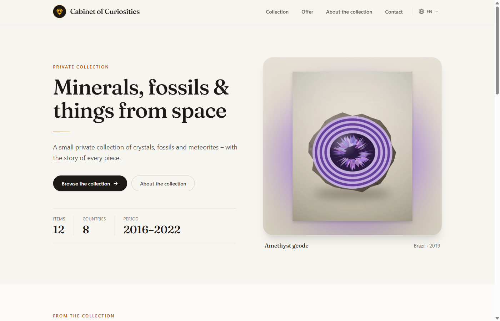
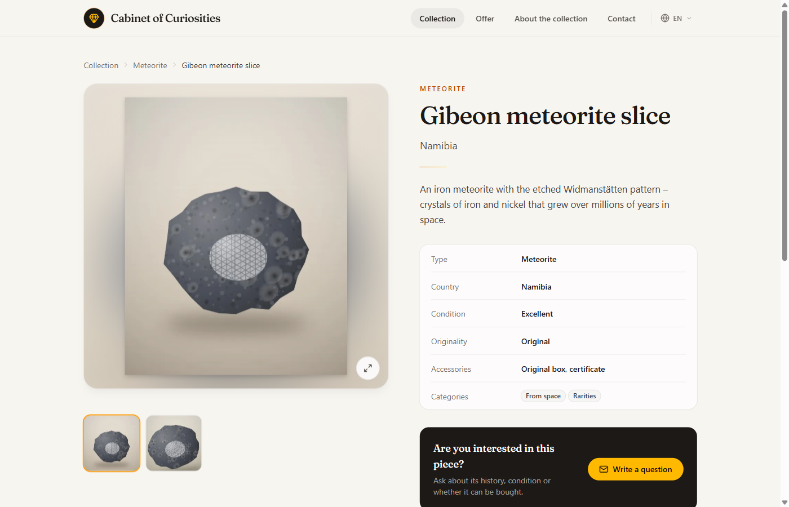
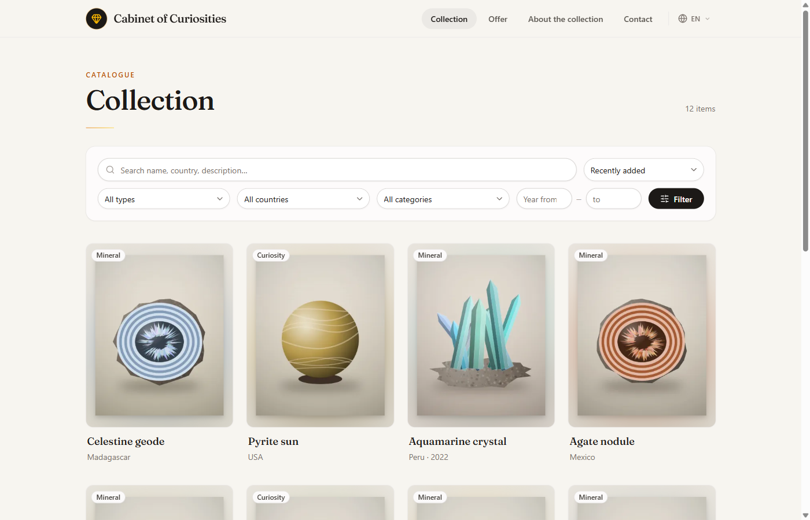
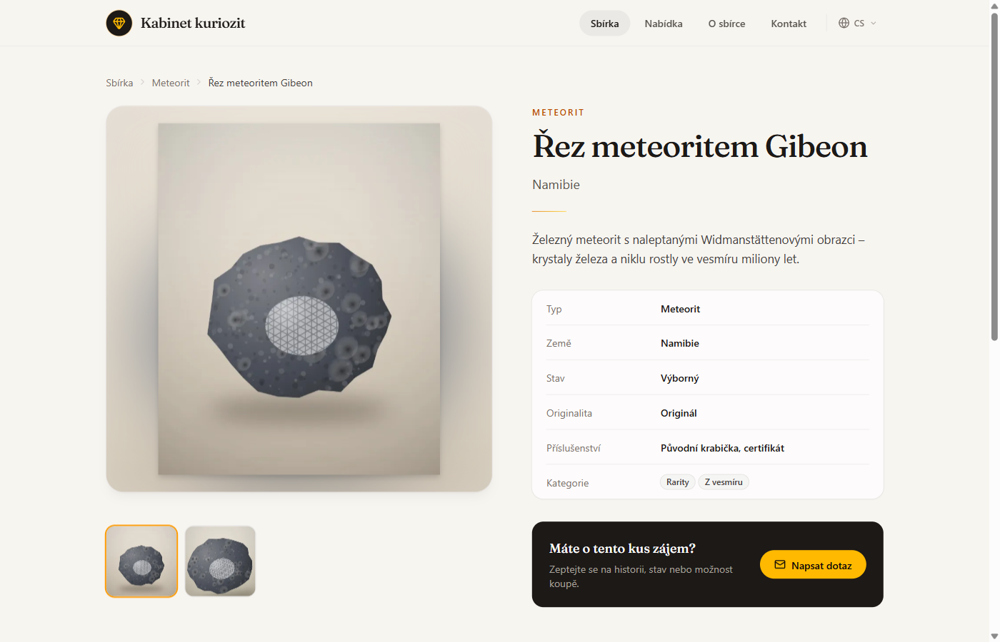
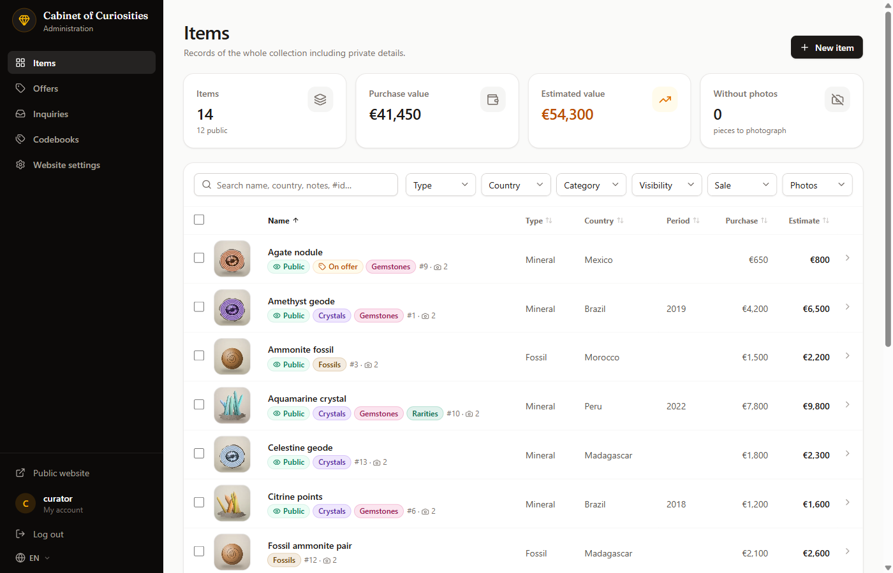
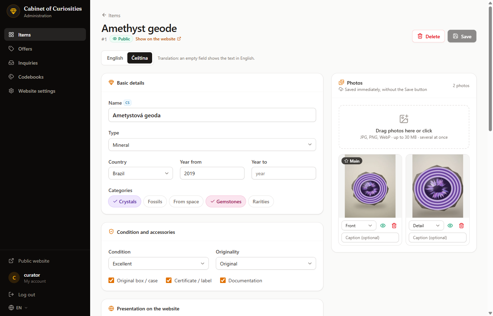
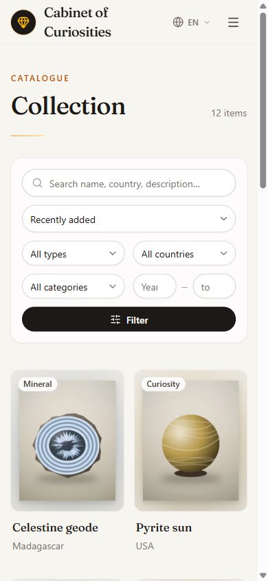

# Collection Catalog

A catalog and showcase for a private collection. Collectors keep a private inventory with prices, provenance and
photos, and publish a selected part as a fast, search-friendly website – with offers for sale and an inquiry form.
Content and interface are multilingual (English and Czech out of the box). The demo shows a cabinet of minerals,
fossils and meteorites, generated by a single command.

| Public catalog | Item detail |
| --- | --- |
|  |  |
|  |  |

| Administration | Editing a translation |
| --- | --- |
|  |  |

<p align="center"></p>

## Features

**Public website** (static server-side rendering)
- Collection with full-text search (diacritics- and case-insensitive), filters by type, country, category and period,
  sorting and paging – all in the URL.
- Item detail with a photo gallery, related items and breadcrumbs.
- Offers for sale or exchange, with an inquiry form: price offers, honeypot field, rate limit per IP, consent and
  automatic deletion of handled inquiries after a year.
- SEO: canonical URLs, `hreflang` alternates, sitemap with images, JSON-LD (WebSite, BreadcrumbList, Product/Offer),
  OpenGraph previews, `noindex` on private pages.

**Administration** (Blazor Interactive Server)
- Item list with filters, sorting and bulk publishing; the state lives in the URL, so *Back* restores it.
- Item editor with unsaved-changes protection, offers panel and a photo manager.
- Photo pipeline with SkiaSharp: EXIF orientation applied, metadata (GPS) stripped, master JPEG plus WebP variants
  (400/800/1600 px), file names from the content hash (cache-friendly, de-duplicated).
- Codebooks for types, categories (with colors), countries and languages; inquiries inbox; website settings.

**Languages**
- Translatable content (names, descriptions, captions, codebooks, website texts) edited one language at a time,
  falling back to the default language when a translation is missing.
- Every language has its own URLs (`/` for the default, `/cs/…` for others) and translated slugs.
- Application texts in English in code, translations in resource files (`Resources/AppText.{code}.resx`).

**Security and quality**
- Security headers (CSP `frame-ancestors`, `X-Frame-Options`, `nosniff`, referrer and permissions policy),
  antiforgery on all forms, open-redirect protection, login rate limit per IP plus account lockout.
- Accessibility: skip link, labelled controls, keyboard-friendly dialogs, WCAG AA contrast.
- 220+ tests: services over a temporary SQLite database and end-to-end tests through `WebApplicationFactory`.

## Tech stack

.NET 10 · ASP.NET Core · Blazor (static SSR + Interactive Server) · EF Core + SQLite · Tailwind CSS 4 · SkiaSharp ·
MSTest · Docker · GitHub Actions

## Getting started

Prerequisites: .NET SDK (version in `global.json`) and Node.js (Tailwind CSS is built during `dotnet build`).

```bash
npm ci
dotnet run --project src/CollectionCatalog.Web -- seed-demo
dotnet run --project src/CollectionCatalog.Web -- user-set-password --username admin
dotnet run --project src/CollectionCatalog.Web
```

Open the address printed by `dotnet run`; the administration is at `/admin`. `seed-demo` fills an empty database
with the demo collection (it refuses to touch a database that already holds items). `user-set-password` creates the
account (or resets its password) and reads the password from the console.

In a container: `docker compose up --build` → http://localhost:8080
(`docker compose run --rm web seed-demo`, `docker compose run --rm -it web user-set-password --username admin`).

## Configuration

Settings live in `src/CollectionCatalog.Web/appsettings.json`:

```json
"Storage": { "DataPath": "App_Data" },
"Site": {
  "BaseUrl": "",
  "TimeZone": "UTC",
  "Currency": "EUR",
  "AuthorName": "",
  "AuthorUrl": ""
}
```

| Setting | Default | Purpose |
| --- | --- | --- |
| `Storage:DataPath` | `App_Data` (`/data` in the image) | SQLite database, photos, Data Protection keys, backups |
| `Site:BaseUrl` | address of the request | Public address for canonical URLs, sitemap and social previews |
| `Site:TimeZone` | `UTC` | Time zone of displayed times and dates (IANA id, e.g. `Europe/Prague`) |
| `Site:Currency` | `EUR` | Currency of prices (ISO 4217 code, e.g. `CZK`, `USD`) |
| `Site:AuthorName` | – | Author credit in the footer (hidden when empty) |
| `Site:AuthorUrl` | – | Link of the author credit |

As usual in ASP.NET Core, any setting can be overridden by an environment variable (`Site__Currency=CZK`).

Website texts, contacts and languages are edited in the administration.

## Languages

- **Content** – add a language in *Codebooks → Languages*. Translatable fields get a language switch in the forms;
  the default language lives at the root of the website, other languages under their code (`/de/…`).
- **Application texts** – menus, buttons and messages are English in code (`T["…"]`). A language is translated by
  adding `Resources/AppText.{code}.resx` (see `AppText.cs.resx`); a language without the file shows English
  application texts while its content is still translated. The Languages tab shows which languages have the file.

## Architecture

A single web project with feature folders – no extra layers without a reason:

```
src/CollectionCatalog.Web
  Domain/          entities, enums, LocalizedText
  Data/            DbContext, configurations, migrations
  Services/        Items, Images, Codebooks, Languages, Listings, Inquiries, Public, Site, Users, Demo, Text
  Infrastructure/  storage, authentication, CLI commands, media and SEO endpoints, language middleware
  Components/      Public (static SSR), Admin (interactive), Account, Layout, Shared
  Resources/       UI texts (AppText.*.resx)
tests/CollectionCatalog.Tests
```

Key decisions:
- **One SQLite file** in the data folder – the app runs as a single instance; migrations run at startup and the
  database is backed up (`VACUUM INTO`) before pending migrations.
- **`IDbContextFactory` per operation** in interactive components, never a context living for the whole circuit.
- **Public data only through DTO projections** (`PublicItemQuery` → `PublicDtos`) – private fields such as prices or
  provenance cannot leak into a page; a test guards the DTOs.
- **Translatable content as JSON columns** (`LocalizedText`, `{"en": "…", "cs": "…"}`) with fallback to the default
  language; names are resolved in the final EF projection.
- **Language prefix → `PathBase`** (`LanguagePathMiddleware`): pages and endpoints use the same routes in every
  language and relative links stay in the language thanks to `<base href>`.

## Testing

```bash
dotnet test
```

## License

[MIT](LICENSE). The bundled Fraunces font is licensed under the SIL Open Font License
(`src/CollectionCatalog.Web/wwwroot/fonts/Fraunces-OFL.txt`).

Built by [Martin Goffa](https://github.com/goffamartin).
